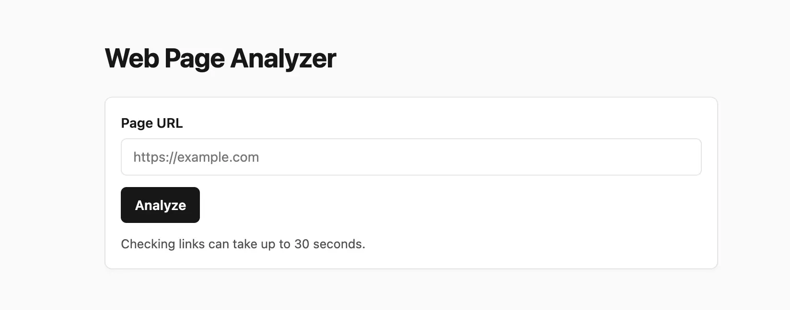
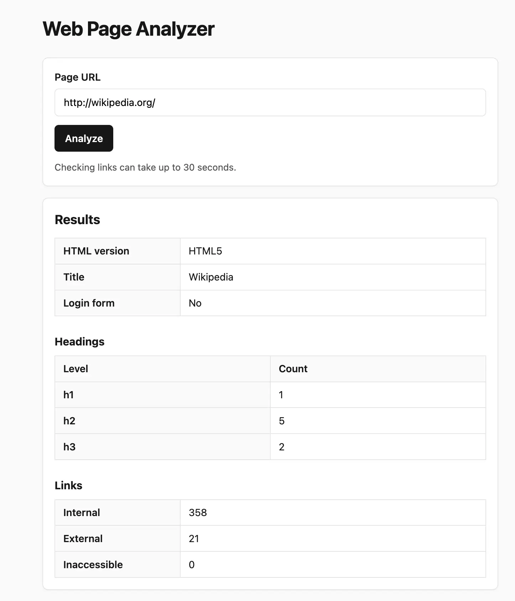
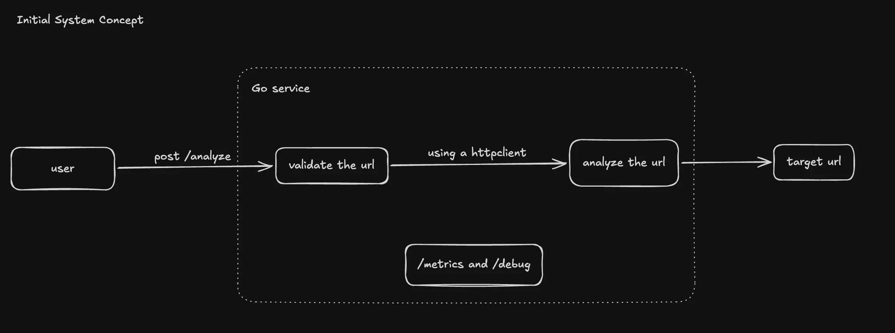
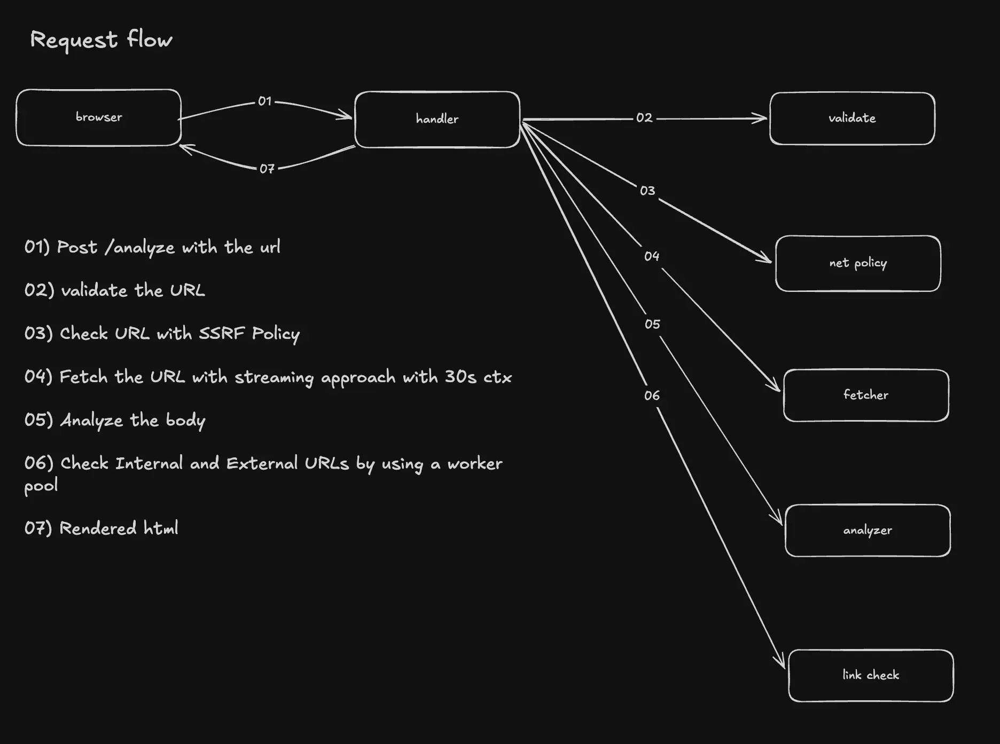

# Web Page Analyzer

Go web application that takes a URL, fetches the page, and return HTML version, title, heading counts, internal vs. external links, inaccessible links, and whether the page contains a login form.

This is a **server side rendering** app. There is **no JavaScript** and no frontend framework.

---

## Table of contents

1. [Project overview](#1-project-overview)
2. [Technology used](#2-technology-used)
3. [Prerequisites and external dependencies](#3-prerequisites-and-external-dependencies)
4. [Setup and running the project](#4-setup-and-running-the-project)
5. [Configuration](#5-configuration)
6. [Usage and main functionality](#6-usage-and-main-functionality)
7. [Architecture](#7-architecture)
8. [Project structure](#8-project-structure)
9. [Endpoints, API docs and specs](#9-endpoints-api-docs-and-specs)
10. [Observability: logging, metrics and pprof](#10-observability-logging-metrics-and-pprof)
11. [Testing](#11-testing)
12. [Security checks](#12-security-checks)
13. [Deployment (Docker and Makefile)](#13-deployment-docker-and-makefile)
14. [Challenges and how they were solved](#14-challenges-and-how-they-were-solved)
15. [Possible improvements](#15-possible-improvements)
16. [References and inspiration](#17-references-and-inspiration)

---


## 1. Project overview

Given a URL, the analyzer reports:


| Result                 | Description                                                                  |
| ---------------------- | ---------------------------------------------------------------------------- |
| **HTML version**       | Detected from the `<!DOCTYPE>` (HTML5, HTML 4.01, XHTML 1.0, and others).    |
| **Page title**         | Content of the first `<title>` element.                                      |
| **Headings**           | Count of `h1` to `h6` elements, per level.                                   |
| **Links**              | Number of **internal** and **external** links.                               |
| **Inaccessible links** | Links that returned a 4xx or 5xx status, timed out, or could not be reached. |
| **Login form**         | Whether the page has a login form.                                           |


**Internal vs. external.** Links are classified by *registrable domain* (eTLD+1, using the public suffix list). `www.example.com`, `m.example.com` and `example.com` are all internal to each other. A link to a different registrable domain is **external**. IPs and `localhost` must match host and port exactly.

**Error handling.** Failures are shown to the user as an HTTP status code with a description (for example `502 Bad Gateway: could not resolve host`).

### Home page



### Analysis results



---


## 2. Technology used


| Area                 | Technology                                                                                             |
| -------------------- | ------------------------------------------------------------------------------------------------------ |
| **Backend**          | Go 1.27 (standard library `net/http`)                                                                  |
| **Frontend**         | Server side rendering HTML + CSS via Go `html/template` (embedded with `go:embed`). **No JavaScript.** |
| **Logging**          | `[log/slog](https://pkg.go.dev/log/slog)` (structured JSON logs)                                       |
| **Metrics**          | [Prometheus client_golang](https://github.com/prometheus/client_golang)                                |
| **Profiling**        | `[net/http/pprof](https://pkg.go.dev/net/http/pprof)`                                                  |
| **DevOps**           | Docker, Docker Compose, Makefile, GitHub Actions, [Trivy](https://trivy.dev/)                          |
| **Testing**          | Go `testing`                                                                                           |
| **Security tooling** | `govulncheck`, `gosec`, `go vet`, Trivy (filesystem + image scan)                                      |


---


## 3. Prerequisites and external dependencies


### Required


| Tool                                                    | Version | Needed for                  |
| ------------------------------------------------------- | ------- | --------------------------- |
| [Go](https://go.dev/dl/)                                | 1.27    | Running and testing locally |
| [Docker](https://docs.docker.com/get-docker/) + Compose | recent  | Container deployment        |


### Optional tools


| Tool            | Install                                                                                            | Used for                                       |
| --------------- | -------------------------------------------------------------------------------------------------- | ---------------------------------------------- |
| `govulncheck`   | `go install golang.org/x/vuln/cmd/govulncheck@latest`                                              | vulnerability scan of Go dependencies          |
| `gosec`         | `go install github.com/securego/gosec/v2/cmd/gosec@latest`                                         | Static security analysis                       |
| `golangci-lint` | `brew install golangci-lint` or see [install docs](https://golangci-lint.run/welcome/install/)     | Extra linting (used by `make lint` if present) |
| `trivy`         | `brew install trivy` or see [install docs](https://trivy.dev/latest/getting-started/installation/) | Dependency and container image scan            |


---


## 4. Setup and running the project

```bash
# 1. Get the code
git clone https://github.com/amila-t-kumarasekara/web-analyzer.git
cd web-analyzer

# 2. (Optional) create a local env file
cp .env.example .env

# 3. Run
make run or make docker-run  or make up
```

Open [http://localhost:8080](http://localhost:8080), enter a URL such as `https://example.com`, and press **Analyze**.

Run `make help` for the full list of targets. Key targets:


| Target                  | Description                                    |
| ----------------------- | ---------------------------------------------- |
| `make run`              | Run the server locally                         |
| `make build`            | Compile to `bin/server` (`CGO_ENABLED=0`)      |
| `make test`             | Unit tests with the race detector              |
| `make cover`            | Unit tests with coverage; fails below 70%      |
| `make test-integration` | Unit + integration tests (`-tags=integration`) |
| `make lint`             | `go vet` and `golangci-lint` (if installed)    |
| `make tidy`             | `go mod tidy`                                  |
| `make docker-build`     | Build the production image                     |
| `make docker-run`       | Build and run the container on `:8080`         |
| `make up` / `make down` | Docker Compose up / down                       |


---


## 5. Configuration

Configuration is read from environment variables.


| Variable     | Default          | Description                                                                                   |
| ------------ | ---------------- | --------------------------------------------------------------------------------------------- |
| `PORT`       | `8080`           | Port for the public web server.                                                               |
| `ADMIN_ADDR` | `127.0.0.1:6060` | Listen address for the **admin** server (pprof and `/metrics`). Bound to loopback by default. |


Built in limits and timeouts live in `pkg/consts/consts.go`:


| Limit                     | Value           |
| ------------------------- | --------------- |
| Max URL length            | 2048 characters |
| Max page size             | 10 MiB          |
| Whole analysis timeout    | 30 s            |
| Link-check timeout        | 20 s            |
| Link-check worker pool    | 32 workers      |
| Per-link HTTP timeout     | 15 s            |
| Graceful shutdown timeout | 15 s            |


---


## 6. Usage and main functionality

1. Open [http://localhost:8080](http://localhost:8080).
2. Enter a page URL (the scheme is optional: `example.com` becomes `https://example.com`).
3. Submit the form. The results page shows the table of findings and a collapsible list of inaccessible links.
4. If something goes wrong, an error box shows the status code and a description.


### Main functionality and its role


| Capability                   | Role in the application                                                                                       |
| ---------------------------- | ------------------------------------------------------------------------------------------------------------- |
| **URL validation**           | Rejects empty, oversized, non HTTP(S) or malformed inputs                                                     |
| **Page fetching**            | Fetches the HTML with timeouts, a size limit and with a content type check (only HTML or XHTML).              |
| **HTML analysis**            | Single pass streaming tokenizer extracts DOCTYPE, title, headings, links and login forms.                     |
| **Link classification**      | Resolves relative links                                                                                       |
| **Concurrent link checking** | Worker pool checks every unique link with `HEAD`, falling back to `GET` when `HEAD` is unsupported (405/501). |
| **Error handling**           | Typed errors map to user friendly messages and proper status codes (400, 413, 415, 502, 504, and so on).      |
| **Logging**                  | Structured JSON request logs with a request ID.                                                               |
| **Metrics and profiling**    | Prometheus counters/histograms and pprof on a separate admin port.                                            |
| **SSRF protection**          | Blocks requests to loopback, private and link-local addresses (see [Security](#12-security-checks)).          |


### URL validation

Implemented in `internal/validate` using only the standard library:

1. Trim whitespace; reject empty or over 2048 characters.
2. Normalize: `//host` becomes `https://host`, and a bare `host` becomes `https://host`.
3. Match the regex `(?i)^https?://[^\s]+$` (`consts.URLPrecheck`).
4. Strip the fragment, then `url.ParseRequestURI`.
5. Require an `http`/`https` scheme and a non empty hostname.

On failure the user sees a specific message

### Error responses


| Situation                    | Status shown    | Message (example)                                                                                 |
| ---------------------------- | --------------- | ------------------------------------------------------------------------------------------------- |
| Invalid or empty URL         | 400             | Please enter a valid http or https URL (for example, [https://example.com](https://example.com)). |
| Blocked target (SSRF policy) | 400             | That URL is not allowed.                                                                          |
| Target returned non-2xx      | target's status | e.g. Not Found                                                                                    |
| Target is not HTML           | 415             | response is not HTML                                                                              |
| Page too large               | 413             | page exceeds size limit                                                                           |
| DNS failure                  | 502             | could not resolve host                                                                            |
| Connection failure           | 502             | could not reach server                                                                            |
| Timeout                      | 504             | request timed out                                                                                 |
| Unparseable HTML             | 500             | Could not parse the page HTML.                                                                    |
| Link check ran out of time   | notice          | Link check timed out: checked N of M links. Counts for inaccessible links may be low.             |


---


## 7. Architecture

The app is a single Go binary with a layered layout. Dependencies point inward: the HTTP layer depends on small interfaces, and the concrete fetcher and link checker are wired together in `main`.



### Request flow for `POST /analyze`



### Concurrency design

Link checking is the only concurrent part (`internal/linkcheck`):

- A **bounded worker pool** (default 32 goroutines) reads URLs from an unbuffered `jobs` channel.
- Results are sent on a **buffered** `results` **channel** sized to the number of URLs, so workers never block.
- A `sync.WaitGroup` tracks the workers; a dedicated goroutine closes `results` after `wg.Wait()`.
- A producer goroutine feeds `jobs` and stops on `ctx.Done()`, so a timeout or client disconnect does not leak goroutines. When that happens the result is flagged `Incomplete` and the UI shows a notice.


### Middleware chain

`requestID` → `observe` (logging and Prometheus) → `recover` (panic to 500) → router.

### Graceful shutdown

`main` listens for `SIGINT`/`SIGTERM`, then shuts down both the public and admin servers with a 15 s timeout.

---


## 8. Project structure

```text
web-analyzer/
├── cmd/
│   └── server/
│       └── main.go             # Entry point: wiring, servers, graceful shutdown
├── internal/
│   ├── analyzer/               # HTML parsing: doctype, title, headings, links, login form
│   ├── config/                 # .env configuration
│   ├── fetcher/                # Fetches a page; maps network errors to fetcher.Error
│   ├── httpclient/             # Outbound http.Client factories (timeouts, SSRF-safe dialer)
│   ├── linkcheck/              # Concurrent link checker (worker pool)
│   ├── netpolicy/              # SSRF policy: blocks private/loopback/local targets
│   ├── validate/               # URL normalization and validation
│   └── web/                    # HTTP handler, middleware, embedded HTML template
│       └── templates/index.html
├── pkg/
│   ├── consts/                 # Shared limits, timeouts, defaults, URL regex
│   ├── doctype/                # DOCTYPE identifier to HTML version tables
│   └── errs/                   # Shared sentinel errors
├── tests/
│   └── integration/            # Full  tests (build tag: integration)
├── .github/workflows/
│   └── docker-scan.yml         # CI: Trivy dependency scan, Docker build, image scan
├── .env.example                # Example configuration
├── Dockerfile                  # Multi stage build (deps, builder, runtime)
├── docker-compose.yml
├── Makefile
├── go.mod / go.sum
└── README.md
```

---


## 9. Endpoints, API docs and specs

The app is a server side rendering HTML application, not a JSON API.

**Public server** (`PORT`, default `:8080`)


| Method | Path       | Description                                       |
| ------ | ---------- | ------------------------------------------------- |
| `GET`  | `/`        | Analyzer form                                     |
| `POST` | `/analyze` | Form field `url`; returns the results page (HTML) |
| `GET`  | `/healthz` | Liveness probe; returns `200 ok`                  |


**Admin server** (`ADMIN_ADDR`, default `127.0.0.1:6060`)


| Method | Path            | Description                                   |
| ------ | --------------- | --------------------------------------------- |
| `GET`  | `/metrics`      | Prometheus metrics                            |
| `GET`  | `/debug/pprof/` | pprof index (heap, goroutine, profile, trace) |


Example with `curl`:

```bash
curl -s -X POST http://localhost:8080/analyze --data-urlencode "url=https://example.com" | less
curl -i http://localhost:8080/healthz
```

Local URLs when running:


| What           | URL                                                                      |
| -------------- | ------------------------------------------------------------------------ |
| Frontend (UI)  | [http://localhost:8080](http://localhost:8080)                           |
| Backend health | [http://localhost:8080/healthz](http://localhost:8080/healthz)           |
| Metrics        | [http://localhost:6060/metrics](http://localhost:6060/metrics)           |
| pprof          | [http://localhost:6060/debug/pprof/](http://localhost:6060/debug/pprof/) |


---


## 10. Observability: logging, metrics and pprof


### Logging (`log/slog`)

All logs are structured JSON via the standard `log/slog` package (no manual formatting). Each request logs method, path, status, duration and `request_id`:

```json
{"time":"...","level":"INFO","msg":"request","method":"POST","path":"/analyze","status":200,"duration":812345678,"request_id":"3f9a1c2b7d4e8a10"}
```

The `X-Request-ID` header is honoured if the client sends it; otherwise one is generated and returned in the response.

### Prometheus metrics

Exposed at `/metrics` on the **admin** port:


| Metric                          | Type      | Labels                   |
| ------------------------------- | --------- | ------------------------ |
| `http_requests_total`           | counter   | `method`, `path`, `code` |
| `http_request_duration_seconds` | histogram | `method`, `path`         |


### pprof

Available at `/debug/pprof/` on the admin port:

```bash
go tool pprof http://localhost:6060/debug/pprof/heap
go tool pprof "http://localhost:6060/debug/pprof/profile?seconds=30"
curl -s "http://localhost:6060/debug/pprof/goroutine?debug=1" | head
```

---


## 11. Testing


### Unit tests

```bash
make test        # go test -race ./internal/... ./pkg/...
make cover       # same testing approach with coverage
```

View the coverage report:

```bash
go tool cover -html=tmp/cover.out
go tool cover -func=tmp/cover.out
```


### Integration tests

Located in `tests/integration` behind the `integration` build tag,:

```bash
make test-integration
# or
go test -race -tags=integration ./tests/...
```


### Static checks

```bash
make lint        # go vet ./... and golangci-lint if installed
```


## 12. Security checks


### Run locally

```bash
# Known vulnerabilities in dependencies and stdlib
govulncheck ./...

# Static security analysis
gosec ./...

# Go vet
go vet ./...

# Dependency (filesystem) scan: high/critical only
trivy fs --scanners vuln --severity CRITICAL,HIGH --ignore-unfixed .

# Container image scan
make docker-build
trivy image --severity CRITICAL,HIGH --ignore-unfixed web-analyzer:latest

# Race detector (also part of make test)
go test -race ./internal/... ./pkg/...
```


### CI

`.github/workflows/docker-scan.yml` runs on every push to `master` and on pull requests:

1. Trivy filesystem scan of Go module dependencies (fails on CRITICAL or HIGH with a fix available).
2. Docker image build (Buildx, with cache).
3. Trivy scan of the built image (OS and library packages).


### Security measures built into the app


| Measure                                                                                                                                             | Where                                             |
| --------------------------------------------------------------------------------------------------------------------------------------------------- | ------------------------------------------------- |
| **SSRF protection**: blocks localhost, `metadata.google.internal`, loopback, RFC 1918 private, link-local, unspecified and IPv6 unique-local ranges | `internal/netpolicy`                              |
| **Checked at connect time**: the custom dialer re-validates every resolved IP, which defeats DNS rebinding and mixed A-record tricks                | `internal/httpclient`                             |
| **Redirect validation**: every redirect hop is re-checked and redirects are capped at 10                                                            | `netpolicy.CheckRedirect`                         |
| Only `http`/`https` schemes accepted                                                                                                                | `internal/validate`, `netpolicy`                  |
| Response size limit (10 MiB) and content-type check                                                                                                 | `internal/fetcher`                                |
| Timeouts on every stage (connect, TLS, headers, request, server read/write)                                                                         | `pkg/consts`, `internal/httpclient`, `cmd/server` |
| Bounded concurrency (worker pool) and bounded body drain for link checks                                                                            | `internal/linkcheck`                              |
| HTML output auto-escaped by `html/template`                                                                                                         | `internal/web`                                    |
| Panic recovery middleware                                                                                                                           | `internal/web/middleware.go`                      |
| pprof/metrics on a separate loopback-by-default port                                                                                                | `cmd/server/main.go`                              |
| Container runs as a **non-root** user with a minimal Alpine runtime image                                                                           | `Dockerfile`                                      |


---


## 13. Deployment (Docker and Makefile)

```bash
make docker-build                                  
docker run --rm -p 8080:8080 web-analyzer:latest  
```

To also reach pprof/metrics from the host, publish the admin port and bind it to all interfaces inside the container:

```bash
docker run --rm -p 8080:8080 -p 6060:6060 -e ADMIN_ADDR=:6060 web-analyzer:latest
```


### Docker Compose

```bash
make up      
make down
```

Compose publishes `8080` (app) and `6060` (admin), reads an optional `.env`, and uses `restart: unless-stopped`.

### Without Docker

```bash
make build
PORT=8080 ./bin/server
```

---


## 14. Challenges and how they were solved


| Challenge                                                            | Approach                                                                                                                                                                                  |
| -------------------------------------------------------------------- | ----------------------------------------------------------------------------------------------------------------------------------------------------------------------------------------- |
| **Slow or hanging link checks** on pages with hundreds of links      | A bounded worker pool with channels and a `WaitGroup`, a per link timeout, and a global link check deadline. If time runs out the UI says how many links were checked instead of failing. |
| **What counts as "external"** (`www.`, subdomains, ports)            | Classification by registrable domain using the public suffix list, with exact host:port matching for IPs/localhost.                                                                       |
| **Servers rejecting** `HEAD` (405/501)                               | `HEAD` first for cheap checks, automatic `GET` fallback with the body drain capped at 64 KiB.                                                                                             |
| **Some sites block unknown clients**                                 | Sends a descriptive `User-Agent` plus browser-like `Accept` headers on link checks.                                                                                                       |
| **Black-holed IPv6 delaying every request**                          | Custom dialer tries IPv4 addresses first, with a short fallback delay.                                                                                                                    |
| **SSRF risk**: the app fetches user supplied URLs                    | Central `netpolicy` package, enforced at validation, at redirect hops, and inside the dialer on every resolved IP.                                                                        |
| **Detecting the HTML version**                                       | Parsing DOCTYPE public/system identifiers against lookup tables (`pkg/doctype`), with HTML5 as the default for `<!DOCTYPE html>`.                                                         |
| **Login form detection** without false positives                     | Password field, or a login hint on the form plus a username like field. Nested forms are ignored as the HTML5 parser does.                                                                |
| **Parsing large or malformed HTML**                                  | Streaming `html.Tokenizer` in a single pass, with a hard page size cap.                                                                                                                   |
| **Integration tests vs. SSRF policy** (test servers are on loopback) | A test only switch (`SetInsecureSkipForTesting`) restored via `t.Cleanup`.                                                                                                                |
| **Keeping the app simple**                                           | Server side rendered template, no JS, no Swagger, and a small set of dependencies.                                                                                                        |


---


## 15. Possible improvements

- **Injectable DNS resolver** in `netpolicy` so handler unit tests need no DNS, and raise coverage for `netpolicy`, `fetcher` and `httpclient`.
- Replace the package level `SetInsecureSkipForTesting` flag with an injected policy object.
- **Rate limiting** per client IP and a **cache** for recent analyses.
- **JSON API** (`/api/v1/analyze`) alongside the HTML UI, with an OpenAPI spec if consumers appear.
- **Async analysis** with progress for very large pages (job ID and polling, or SSE).
- Make timeouts, worker count and page size limits **configurable** via environment variables.
- Deeper analysis: meta tags, images, `rel=nofollow`, canonical URL, `robots.txt` awareness.
- **Authentication** for the admin port, or a separate network, instead of relying on binding to loopback.
- OpenTelemetry tracing and a Grafana dashboard for the Prometheus metrics.
- Lowercase `path` metric label guard (currently the raw request path).

---


## 16. References and inspiration

Articles or projects that informed the design and implementation of this project.

### Go language, concurrency and project layout


| Topic                            | Reference                                                                                                                                                                                    |
| -------------------------------- | -------------------------------------------------------------------------------------------------------------------------------------------------------------------------------------------- |
| Go Mistakes                      | [100 Go Mistakes and How to avoid them](https://100go.co/)                                                                                                                                   |
| Web crawler concurrency patterns | [How to build a custom web crawler in Go with concurrency superpowers](https://medium.com/@yashbatra11111/how-to-build-a-custom-web-crawler-in-go-with-concurrency-superpowers-c49c9d21bef2) |


### HTML parsing and link classification


| Topic                                             | Reference                                                                                                                                                        |
| ------------------------------------------------- | ---------------------------------------------------------------------------------------------------------------------------------------------------------------- |
| Streaming tokenizer used by `analyzer`            | [golang.org/x/net/html](https://pkg.go.dev/golang.org/x/net/html)                                                                                                |
| Tokenizer walkthrough (text extraction)           | [Golang HTML Tokenizer: extract text from a web page](https://kenanbek.medium.com/golang-html-tokenizer-extract-text-from-a-web-page-kanan-rahimov-8c75704bf8a3) |
| Analyzer (Go, HTML stats and link checks)         | [cojoj/analyzer](https://github.com/cojoj/analyzer)                                                                                                              |
| GoGetURL (Go, Gin, tokenizer based page analysis) | [gayansanjeewa/gogeturl](https://github.com/gayansanjeewa/gogeturl/tree/main)                                                                                    |


